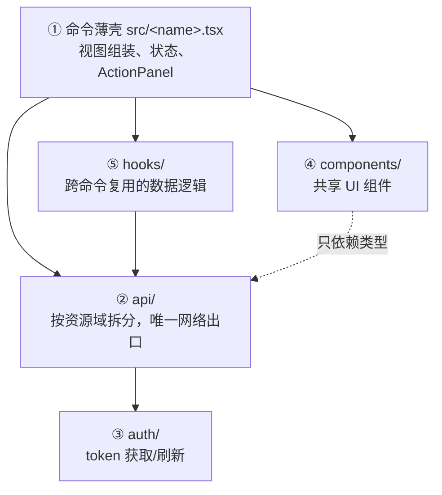

# AGENTS.md

> 本文档约束所有 AI 编程 Agent（Kscc、Claude Code、Cursor、Copilot 等）在本仓库中工作时遵守同一套规范。
> 任何 Agent 开始工作前必须先读完本文档。

## 1. 项目介绍

**wps-raycast** 是一个 [Raycast](https://www.raycast.com) 扩展：在 Raycast 中搜索、创建、归类有权限的 WPS 365 文档（智能文档/智能表格），回车在浏览器打开。

| 项 | 值 |
|---|---|
| 形态 | Raycast Extension（TypeScript + React） |
| 架构 | **零后端**：扩展直连 WPS 365 OpenAPI，无中间服务器 |
| 对接平台 | 仅 WPS 365 企业版（`openapi.wps.cn`） |
| 目标平台 | 仅 macOS |
| 分发方式 | 企业内部分发，**不上架 Raycast Store** |
| 技术栈 | pnpm + Makefile + `@raycast/api`（无其他运行时依赖） |

深入设计见 `docs/`（总体架构、鉴权时序、API 选型、安全模型、路线图）。

## 2. 目录结构

> 2026-11 重构：分层参照官方大扩展（github/jira/notion）的通行惯例。
> 关键约束（官方文档确认）：**命令入口文件必须平铺为 `src/<command-name>.tsx`**——manifest 无 `path` 字段、不支持 `src/<name>/index.tsx` 目录形式；因此命令文件保持薄壳，实现下沉到共享层。

```
wps-raycast/
├── AGENTS.md               # 本文件：Agent 行为规范
├── README.md               # 项目入口说明
├── Makefile                # 统一命令入口（install/dev/build/check…）
├── docs/                   # 设计文档（markdown + mermaid）
│   ├── overview.md         # 总体架构与核心决策
│   ├── auth-design.md      # OAuth 登录闭环设计
│   ├── api-design.md       # WPS API 端点选型与验证状态
│   ├── commands-design.md  # 命令交互设计
│   ├── security.md         # 安全模型与清单
│   └── roadmap.md          # 里程碑与待实测清单
├── assets/                 # 图标等静态资源
└── src/
    ├── api/                # ② 数据层：WPS OpenAPI 访问，唯一网络出口
    │   ├── client.ts       #    apiFetch：白名单域名、超时、鉴权注入、错误收敛
    │   ├── files.ts        #    文件搜索/最近/重命名/移动（一个资源域一个文件）
    │   ├── doclibs.ts      #    文档库搜索
    │   ├── airsheet.ts     #    智能表格创建
    │   └── types.ts        #    WPS API 类型 + WpsApiError
    ├── auth/               # ③ 鉴权域：OAuth 授权码流程 + token 生命周期
    │   └── index.ts
    ├── browser/            # 浏览器域：Chrome 标签查重聚焦（osascript，非网络）
    │   └── chrome.ts
    ├── components/         # ④ 共享 UI 组件（无状态、可复用）
    │   └── file-list-item.tsx
    ├── hooks/              # ⑤ 共享数据 hooks（出现第二个复用方时再填充）
    ├── search-documents.tsx  # ① 命令薄壳：视图组装 + 状态，不写请求
    ├── recent-documents.tsx  # ①
    └── create-document.tsx   # ①（已下线，代码保留）
```

### 分层规则（高内聚低耦合）

依赖方向**单向向下**，禁止反向依赖：



| 规则 | 说明 |
|---|---|
| 命令不碰网络 | `src/<name>.tsx` 只做视图与状态组装；`fetch` 出现在 `api/` 之外即打回 |
| api 按资源域分文件 | 一个 WPS 资源域（files/doclibs/airsheet）一个文件，导出函数而非裸对象 |
| api/auth 不依赖 UI | `api/`、`auth/` 禁止 import `@raycast/api` 的 UI 组件（toast 等）与 `components/` |
| 组件只依赖类型 | `components/` 只 import `api/types` 的类型与纯函数，不直接发请求 |
| 先复用后抽层 | 共享逻辑在第二个使用方出现时才下沉到 `hooks/`、`components/`，不预建空结构 |

## 3. 常用命令

```bash
make install    # 安装依赖（pnpm）
make dev        # Raycast 调试运行
make typecheck  # tsc --noEmit
make lint       # Raycast lint
make check      # typecheck + lint
```

- 包管理只用 **pnpm**，不要生成 `package-lock.json`。
- 提交前必须通过 `make typecheck`。

## 4. 编码规范

### 4.1 语言与风格

- TypeScript strict 模式；禁止 `any`（API 边界用 `unknown` + 类型收敛）。
- React 函数组件 + hooks；遵循 Raycast 官方扩展惯例（List/Form/ActionPanel）。
- 注释与用户可见文案用中文；代码标识符用英文。
- 注释写「为什么」，不写「是什么」；与 docs/ 设计文档互相引用。

### 4.2 安全红线（违反即打回）

1. **禁止硬编码任何密钥**：`client_id`/`client_secret` 只能来自 preferences；不出现 `AKLT` 前缀字符串。
2. **token 不落日志**：`console.*` 不得输出 access_token、refresh_token、client_secret、原始响应体。
3. **唯一网络出口**：所有 API 调用走 `apiFetch`（`src/api/client.ts`），域名白名单 `https://openapi.wps.cn`；新增端点必须加在 `API_BASE` 之下，禁止请求用户可控 URL。
4. **token 只存 `PKCEClient`**：禁止 localStorage / Cache 存 token。
5. **所有请求带超时**：`AbortSignal.timeout(15_000)`。
6. **不引入新的运行时依赖**：如确需，先在 issue/PR 中说明理由。

### 4.3 WPS API 使用约定

- 端点状态分两级：✅ 已验证（有官方文档佐证）/ ⚠️ 待实测（在代码 `TODO` 注释与 `docs/roadmap.md` 标注）。新端点先查 `docs/api-design.md`，不要凭记忆写端点。
- 错误统一抛 `WpsApiError`；HTTP 200 但 `body.code != 0` 也是错误。
- 未知响应字段不透传到 UI，只在 `api/types.ts` 与各 api 文件的 normalize 函数中收敛确认过的字段。

### 4.4 变更流程

1. 改代码 → `make typecheck` 通过；
2. 涉及设计变更时**同步更新 `docs/` 对应文档**（文档与代码不允许漂移）；
3. 提交信息用中文，格式 `<type>: <摘要>`（feat/fix/docs/build/refactor）。

## 5. 文档生成规范（重要）

Agent 在本仓库生成任何文档（`docs/`、README、PR 描述、设计说明）时，遵守以下原则：

### 5.1 核心原则：保持信息熵，改变呈现形式

人类不擅长阅读大段文字。输出时**信息量不能丢**，但呈现方式要为可读性服务：

1. **能用图就不用文字**：流程、时序、状态、架构、里程碑 → 用 mermaid（`flowchart` / `sequenceDiagram` / `stateDiagram-v2` / `gantt`）。
2. **能用表就不用段落**：参数、对比、清单 → markdown 表格。
3. **文字必须短**：用 [ASD-STE100](https://en.wikipedia.org/wiki/Simplified_Technical_English) 精神约束中文写作——
   - 一句一个主张，句子 ≤ 25 字；
   - 用主动语态、具体动词（「扩展调用 API」，不用「API 被扩展所调用」）；
   - 删除所有客套话、废话、重复修饰（「非常」「基本上」「其实」）；
   - 术语全仓库统一（见 `docs/` 已有用法，如「delegated token」「企业自建应用」）。
4. **复杂主题可生成交互式网页**：内容超过 3 张图 + 2 张表仍难阅读时，产出一个独立 HTML（放 `docs/`，纯静态、无构建依赖）作为补充视图。

### 5.2 事实依据要求

- 每个技术结论必须可追溯：标来源（官方文档 URL / 代码行号 / 实测记录）。
- 区分三档置信度并显式标注：**已验证**（有来源）/ **待实测**（合理推断）/ **未确认**（无来源）。
- 禁止编造 API 端点、参数、响应字段；不确定就写「待实测」并加入 `docs/roadmap.md` 的实测清单。
- 引用外部调研结论时注明时间（API 会变，如「2026-10 调研」）。

### 5.3 文档自检清单

写完文档后逐项自检：

- [ ] 没有连续超过 5 行的纯文字段落
- [ ] 流程/时序/状态有图，参数/对比有表
- [ ] 每个结论有来源或标注置信度
- [ ] 无空洞修饰词，句子短而主动
- [ ] 与代码现状一致（文档不漂移）
