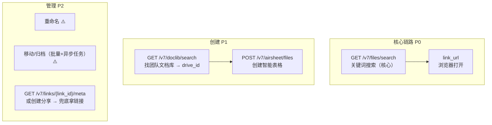

# API 选型设计

> 结论来源：2026-10 对 open.wps.cn 官方文档的逐字核验（含文档站公开数据 API 直取）。
> 标注 ✅ 的端点已验证存在与参数；标注 ⚠️ 的端点存在但参数/响应需实测后固化。

## 1. 端点全景

## 2. 核心：文件搜索 `GET /v7/files/search` ✅

这是整个扩展的基石，已验证的关键参数：

| 参数 | 取值 | 说明 |
|---|---|---|
| `keyword` | 用户输入 | 关键词 |
| `type` | `all` | 文件名 + 内容搜索 |
| `scope` | `all` | **用户全部有权限文件**（也支持 `latest` / `personal_drive` / `group_drive` / `share_to_me` / `share_by_me` / `recycle` 等） |
| `file_exts` | `".ap,.ksheet"` | 可选，按后缀过滤智能文档/智能表格 |
| `with_link` | `true` | 返回 `link_url`（`https://www.kdocs.cn/l/{link_id}`） |
| `with_permission` | `true` | 返回权限信息 |
| `page_size` | ≤ 500（公网上限） | 分页 |
| `page_token` | — | 翻页 token |

- **限频**：官方标注「无」。
- **返回**：`data.items[].file`（`file_id`、`drive_id`、`name`、`mtime`、`created_by`、`link_url`、`shared`…）+ `data.next_page_token` + `data.total`。
- **scope 权限**：用户授权 `kso.file_search.readwrite`（实测确认；`kso.file.search` 命名在用户授权下会报 `invalid_scope`）。

### 语义搜索（二期备选）`POST /v7/aidocs/hub/files/ai_search` ✅

语义多路召回，返回命中片段与 score。依赖租户 AI 权益（需管理员开通）+ 文档入库状态查询接口。第一版不做。

## 3. 最近文件

优先复用 `GET /v7/files/search` + `scope=latest`（零新增端点、零新增 scope）。
⚠️ 需实测：`keyword` 传空是否合法；若必须传词，改用官方最近文件端点。

## 4. 创建文档（P1）

| 步骤 | 端点 | 状态 |
|---|---|---|
| 选目标空间（团队文档库） | `GET /v7/doclib/search`（keyword 搜库名，返回 `drive_id`） | ✅ |
| 创建智能表格 | `POST /v7/airsheet/files`（`drive_id` + 文件名带 `.ksheet` 后缀） | ✅ 端点已验证；⚠️ 响应字段路径需实测 |
| 创建智能文档 `.ap` | REST 直接创建的类型清单未确认 | ⚠️ 落地时以文档为准 |
| 我的空间创建 | 需确认「我的空间 drive_id」获取方式 | ⚠️ |

## 5. 归类/管理（P2）

官方「知识库内容管理」模块确认具备：重命名、单/批量移动、批量复制、异步任务进度查询。⚠️ 具体 REST 路径落地时从文档树（`open.wps.cn/docs/api/collections/wps365`）抓取固化。

未分享文件无 `link_url` 的兜底链：`GET /v7/links/{link_id}/meta`（需 `kso.file_link.readwrite`）或走「创建分享」API。

## 6. 客户端层约定

- **Base URL 固定** `https://openapi.wps.cn/v7`，代码中为常量白名单（零 SSRF 面）。
- **鉴权**：`Authorization: Bearer {access_token}`。KSO-1 请求签名是**可选的**（仅当应用在后台开启签名才必填），第一版不实现签名。
- **错误约定**：HTTP 200 但 `body.code != 0` 是业务错误；统一抛 `WpsApiError(code, msg)`，UI 层 toast 展示。已知错误：`403000001` = 用户对目标文件无权限。
- **超时**：所有请求 `AbortSignal.timeout(15s)`。
- **响应处理**：只取文档确认过的字段，未知字段不透传到 UI。
