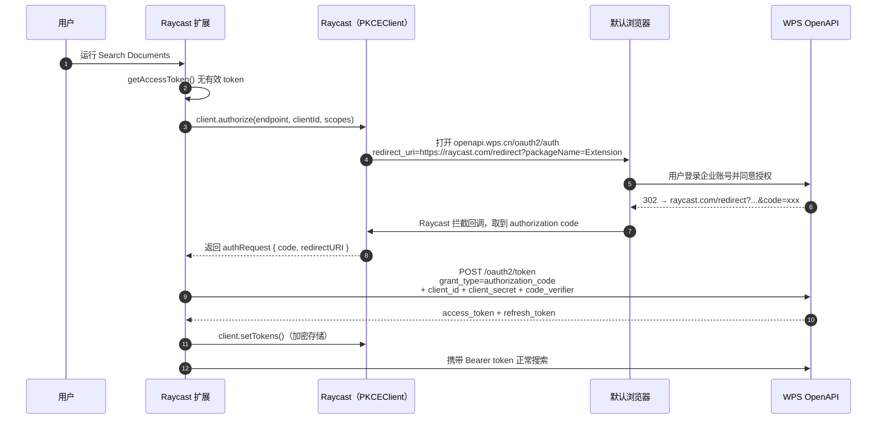
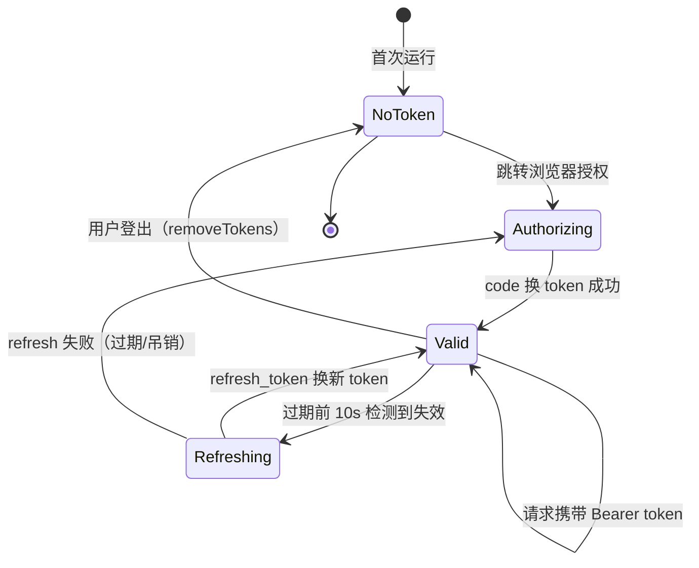

# 鉴权设计（零后端 + 首次使用跳转登录）

## 1. 目标体验

用户安装扩展、填好 Client ID / Client Secret 后，第一次运行任意命令时：

1. Raycast 弹出一条「连接 WPS 365 账号」的授权提示；
2. 自动跳转**默认浏览器**打开 WPS 登录/授权页（用户已登录企业账号则一键同意）；
3. 授权成功 → WPS 重定向到 Raycast 托管回调 → Raycast 把授权码回传给扩展；
4. 扩展本地用 client_secret 换 token，加密存储；
5. 之后所有使用静默完成，token 过期自动刷新，用户无感。

**全程无后端参与。**

## 2. 为什么用授权码模式（delegated token）而不是纯 AK/SK

| 方案 | 身份 | 能否搜"我"的文档 | 结论 |
|---|---|---|---|
| AK/SK `client_credentials`（应用身份） | 应用 | ❌ 无用户上下文，搜不了"某用户有权限的文件" | 只能做企业级接口，不满足核心需求 |
| **授权码模式（用户授权）** | 用户本人 | ✅ `scope=all` = 当前用户全部有权限文件 | **选它** |

调研确认：WPS 用户维度接口（文件搜索、最近文件、我的文档库）必须走用户授权 token。

## 3. 首次授权时序

**前提配置（一次性，管理员在 WPS 开放平台后台操作）**：

1. 创建「企业自建应用」，得到 Client ID（AK）与 Client Secret（SK）；
2. 在「开发配置 → 安全设置 → 用户授权回调配置」登记 `https://raycast.com/redirect?packageName=Extension`（Raycast 扩展的固定回调地址，不可自定义）；
3. 为应用申请 scope 并提交企业管理员审批：`kso.file_search.readwrite`、`kso.file.readwrite`、`kso.user_base.read`。

## 4. Token 生命周期

| 项 | 设计 |
|---|---|
| 存储 | `PKCEClient.setTokens()` → Raycast 加密数据库；access/refresh token **绝不**写入 `localStorage`、日志或 Clipboard |
| 过期检测 | TokenSet 无过期字段，把 `{access_token, refresh_token, expires_at}` JSON 编码存入 `idToken` 字段（Raycast 生态通行惯例） |
| 刷新时机 | 剩余有效期 < 10s 时刷新；刷新失败 → 静默重新走授权流程 |
| 有效期 | WPS 文档未公开具体数值（需实测），代码按 `expires_in` 响应字段动态计算，不硬编码 |
| 登出 | `client.removeTokens()`；Raycast 会自动在扩展偏好里出现 logout 项 |

## 5. 关于 PKCE

- Raycast 的 `PKCEClient` 会自动生成并携带 `code_challenge`（S256）；WPS 授权端点支持 `code_challenge` 参数（官方 CLI 二进制内可见），兼容。
- WPS 的 token 端点**强制要求 `client_secret`**，因此授权码交换由扩展手动 `fetch` 完成，而不是交给 PKCEClient 内置交换——这是零后端方案的关键折中（secret 存本地 preferences）。
- **PKCE 全链路生效**：授权请求携带 `code_challenge`（S256），换 token 必须回传 `code_verifier`，否则 WPS 报 `invalid_grant`（4010009，实测踩坑）。
- Raycast 官方 PKCE proxy（oauth.raycast.com）面向其已知合作 provider，不依赖它。

## 6. 已知风险与应对

| 风险 | 应对 |
|---|---|
| client_secret 落在每个用户本地 | 见 [security.md](./security.md)：企业内部分发 + 最小 scope + 可随时在后台重置 |
| WPS token 有效期未公开 | 代码动态读取 `expires_in`；首版上线前实测记录 |
| 回调地址是否接受其他形式 | 已确认 Raycast 固定回调为 `https://raycast.com/redirect?packageName=Extension`，登记该地址即可；若 WPS 校验严格（query 参数），备选登记 `https://raycast.com/redirect/extension` |
| 授权页在浏览器但用户已登录多个账号 | 提示用户确认企业账号；token 关联用户可在授权后调用户信息接口回显 |
