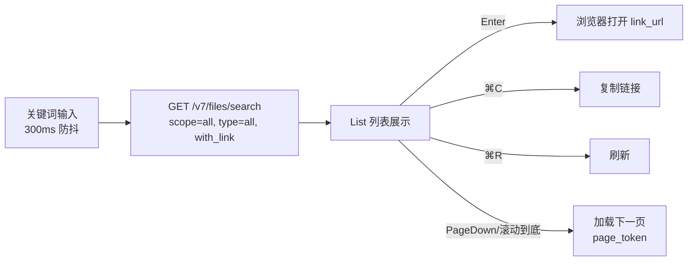
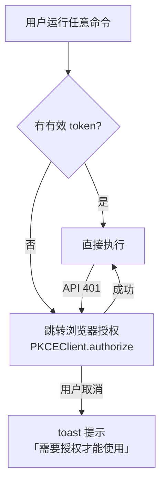

# 命令交互设计

三个命令，对应 Raycast 扩展 manifest 中的 `commands`。设计原则：**搜索是主角，其余一切都在两跳以内**。

## 1. Search Documents（P0，核心）

- **空态**：未输入关键词时默认展示「最近文档」50 条，让命令一打开就有完整内容。
- **搜索语义**：只按文件名搜索（`type=file_name`），不按文件类型过滤。
- **列表项**：标题 = 文件名；副标题 = 修改者；右侧 accessories = 修改时间；未分享文件显示「无链接」标记。
- **分页**：Raycast 内置 `pagination`（`hasNextPage` + `onLoadMore`），滚动到底自动加载。
- **ActionPanel 规划（P2 接入）**：重命名（⌘E）、移动到文件夹（⌘⇧M）、复制 file_id——为归类能力预留入口。

## 2. Recent Documents（P0）

- 数据源：`GET /v7/files/search` + `scope=latest`，与搜索命令共享 api 层。
- 展示：按修改时间排序的 List，无搜索框过滤（Raycast 自带 filter 即可）。
- 回车行为与 Search Documents 一致。

## 3. Create Document（P1）

- 形态：`mode: "no-view"` → 弹出 Form。
- 表单字段：文件名（必填）、类型（智能表格 `.ksheet`，P1 仅支持这一种）、目标空间（团队文档库下拉，数据来自 `GET /v7/doclib/search`，记忆上次选择）。
- 成功后：toast + 直接在浏览器打开新文档。

## 4. 首次使用引导

所有命令共用同一入口逻辑 `getAccessToken()`：

用户唯一需要手动做的两件事（README 中图文说明）：
1. 在扩展偏好设置里填 Client ID / Client Secret（来自 WPS 开放平台的企业自建应用）；
2. 第一次运行时在浏览器里点一次「同意授权」。

## 5. 偏好设置（preferences）

| 字段 | 类型 | 必填 | 说明 |
|---|---|---|---|
| `clientId` | textfield | ✅ | 企业自建应用 AK |
| `clientSecret` | **password** | ✅ | 应用密钥 SK，存 Raycast 加密数据库（Keychain） |

无其他必填项——端点、scope 均内置在代码中，保持零配置心智。
