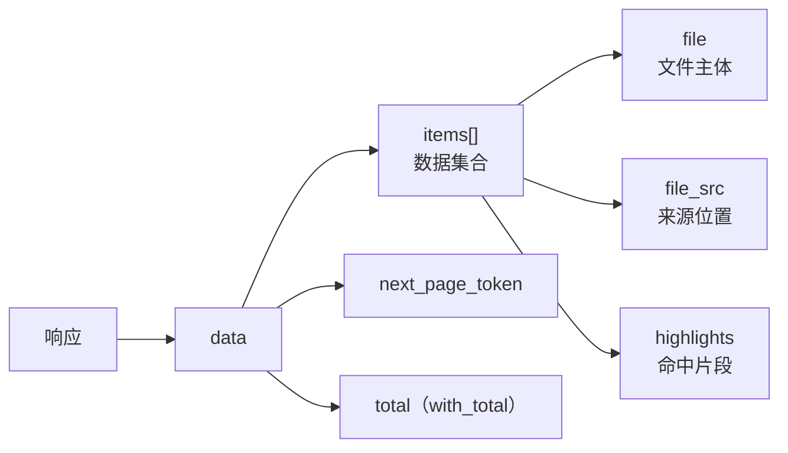

# `GET /v7/files/search` 返回数据字典

> 来源：open.wps.cn 官方文档《文件搜索》（doc id=529），2026-11-01 抓取原文，置信度：已验证。
> 「扩展用途」列标注本仓库 `src/api/files.ts` 的消费情况。

## 1. 顶层结构

| 字段 | 类型 | 必返 | 说明 |
|---|---|---|---|
| `code` | integer | ✅ | 0 = 成功 |
| `msg` | string | ✅ | 人可读信息（可能随语言/地区变化） |
| `data.items[]` | array | ✅ | 每项含 `file` + `file_src` + `highlights` |
| `data.next_page_token` | string | ✅ | 翻页 token（回传 `page_token` 参数） |
| `data.total` | integer | ❌ | 总数（`with_total=true` 时返回） |

## 2. `data.items[].file` —— 文件主体

| 字段 | 类型 | 说明 | 扩展用途 |
|---|---|---|---|
| `id` | string | 文件 id（文档 schema 记载） | ⚠️ 见 §5 命名说明 |
| `file_id` | string | 文件 id（实测响应存在） | List key、后续管理操作 |
| `drive_id` | string | 所在驱动盘 id | 定位空间 |
| `name` | string | 文件名 | 列表标题 |
| `type` | string | 文件类型 | 潜力：按类型显示图标 |
| `size` | integer | 文件大小（字节） | accessories |
| `ctime` / `mtime` | integer | 创建/修改时间，**秒级时间戳** | accessories（⚠️ 见 §5） |
| `version` | integer | 文件版本号 | 未用 |
| `parent_id` | string | 父目录 id | 潜力：目录下钻 |
| `link_id` | string | 分享 id | 兜底取链接 |
| `link_url` | string | 分享链接（kdocs.cn 域名） | **回车浏览器打开** |
| `shared` | boolean | 是否已开启分享（`link.status='open'` 时为 true） | 判断 link_url 可用性 |
| `ext_attrs[]` | array | 扩展属性 `{name, value}` | 未用 |
| `created_by` / `modified_by` | object | 创建者/修改者，**不是字符串**，见下表 | 副标题（`toDisplayName` 收敛取 `.name`） |

### 用户对象（created_by / modified_by）

| 字段 | 类型 | 必返 | 说明 |
|---|---|---|---|
| `id` | string | ✅ | 身份 ID |
| `type` | string | ✅ | `user` / `sp` / `unknown`（降级场景返回 unknown，业务方需降级处理） |
| `name` | string | ❌ | 用户/应用名称 |
| `avatar` | string | ❌ | 头像 |
| `company_id` | string | ❌ | 归属企业 |

## 3. `file.permission`（`with_permission=true` 时返回）

| 字段 | 含义 | | 字段 | 含义 |
|---|---|---|---|---|
| `preview` | 预览 | | `rename` | 重命名 |
| `update` | 编辑/更新 | | `move` | 移动 |
| `share` | 分享 | | `delete` | 删除 |
| `download` | 下载 | | `copy` / `copy_content` | 复制/内容复制 |
| `comment` | 评论 | | `print` | 打印 |
| `history` | 历史版本（仅公网） | | `saveas` | 另存为（仅公网） |
| `new_empty` | 新建 | | `upload` | 上传新版本 |
| `list` | 列表 | | `perm_ctl` | 权限管理 |
| `secret` | 安全文档（仅公网） | | | |

**M3 价值**：展示管理操作前先检查 `permission.rename` / `permission.move`，避免点击后 403。

## 4. `file.drive`（`with_drive=true` 时返回）与 items 其他字段

`drive`：盘信息对象——`id`、`name`、`description`、`source`、`status`、`allotee_id`/`allotee_type`（user/group/app）、`quota{total, used, remaining, deleted}`（字节）、`created_by`、`ctime`/`mtime`。
**M2 价值**：列表副标题直接显示「来自 XX 空间」，无需再查 doclib。

| 字段 | 类型 | 说明 |
|---|---|---|
| `file_src` | object | 文件位置来源：`{type✅, name✅, path?}` |
| `highlights` | map[string][]string | 关键字命中片段 |
| `otime` | integer | 文件打开时间（`latest` 排序依据） |

## 5. 实测注意事项

| # | 事项 | 处理 |
|---|---|---|
| 1 | 文档 schema 记载 `id`，实测响应含 `file_id` | **已兼容**：`normalizeFile` 取 `file_id ?? id ?? link_id`。2026-11 实测 `latest` 范围出现 `file_id` 缺失，导致 List key 缺失、钉选互相命中 |
| 2 | `ctime`/`mtime` 是**秒级**时间戳 | `new Date(seconds * 1000)`，直接传秒会显示 1970 年（待修） |
| 3 | `created_by`/`modified_by` 是对象非字符串 | 已由 `toDisplayName` 收敛（修复记录：subtitle 类型报错） |
| 4 | `type` 字段降级场景返回 `unknown` | 收敛函数天然兼容（无 name 时返回 undefined） |
