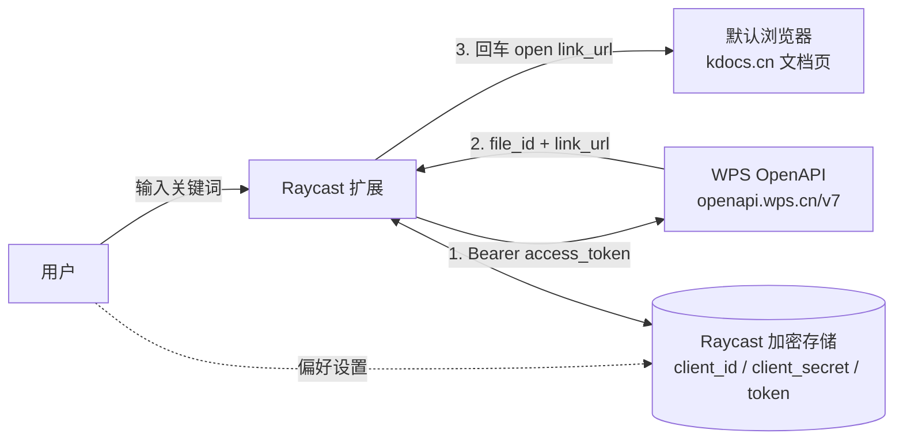

# WPS Docs for Raycast — 总体设计

> 一个零后端（zero-backend）的 Raycast 扩展：在 Raycast 中搜索、创建、归类你有权限的 WPS 365 文档，回车在浏览器打开。

## 1. 背景与目标

团队基于 WPS 生态办公，智能文档/智能表格都开在浏览器里。文档一多就找不到、找起来耗时。本扩展要解决的核心问题：

| # | 能力 | 优先级 |
|---|------|--------|
| ① | 搜索我有权限的智能文档/智能表格，回车浏览器打开 | **P0（核心）** |
| ② | 浏览最近打开的文档 | P0 |
| ③ | 创建文档（智能表格等，指定空间） | P1 |
| ④ | 归类/管理（重命名、移动、归档） | P2 |

**目标平台：仅 macOS。仅对接 WPS 365 企业版（openapi.wps.cn）。** 金山文档个人版（developer.kdocs.cn）搜索 API 存在硬缺口（只能搜本应用自己创建的文件夹），不做第一版范围。

## 2. 核心架构决策：零后端

```
Raycast 扩展 ──HTTPS──▶ WPS 365 OpenAPI (openapi.wps.cn)
     │                        ▲
     │  无任何中间服务器        │
     └────────────────────────┘
```

**决策 D1：不部署任何后端服务。** 扩展直接从用户本地调用 WPS OpenAPI。

- **代价**：OAuth 的 code 换 token 端点需要 `client_secret`，因此 secret 必须存在于用户本地。
- **为什么可以接受**：
  1. 应用类型是「企业自建应用」——secret 本来就归企业自己掌控，泄露影响面 = 企业内部，且可在开放平台后台随时重置（重置后旧密钥立即失效）；
  2. 本扩展**面向企业内部分发，不上架 Raycast Store**，不会进入不可信用户手中；
  3. Raycast 的 password 类型 preference 与 token 都存入 Raycast **本地加密数据库**（password 走系统 Keychain），这是 Raycast 官方认可的安全路径。
- **缓解措施**：见 [security.md](./security.md)（最小 scope、secret 可随时重置、token 不落日志）。

如果未来要公开发布给外部企业用户，再演进为「轻量 token 交换后端」方案（见 [roadmap.md](./roadmap.md)）。

## 3. 技术栈与项目结构

| 项 | 选择 | 理由 |
|---|---|---|
| 运行时 | Raycast Extension（TypeScript + React） | 官方唯一扩展形态 |
| UI | `@raycast/api` 内置 List / List.Item / Form | 无额外 UI 依赖 |
| 鉴权 | `@raycast/api` 的 `PKCEClient` | 提供 redirect 托管 + 加密 token 存储 + 自动 logout 偏好项 |
| 状态 | `useCachedState` / `Cache` | 搜索历史、上次结果缓存 |
| 构建 | `ray build` / `ray develop`（Raycast CLI） | 官方工具链 |

```
wps-raycast/
├── docs/                     # 设计文档（本目录）
├── assets/                   # 图标等静态资源
├── src/
│   ├── auth.ts               # OAuth 授权码流程 + token 生命周期
│   ├── api.ts                # WPS OpenAPI 客户端（白名单端点）
│   ├── types.ts              # WPS API 类型定义
│   ├── search-documents.tsx  # 命令 ①：Search Documents（P0）
│   ├── recent-documents.tsx  # 命令 ②：Recent Documents（P0）
│   └── create-document.tsx   # 命令 ③：Create Document（P1）
├── package.json              # Raycast 扩展 manifest（commands + preferences）
└── tsconfig.json
```

## 4. 端到端数据流



- **搜索**：`GET /v7/files/search`，`scope=all`（用户全部有权限文件）、`type=all`（文件名+内容）、`with_link=true`（直接返回 `link_url`）。
- **打开**：回车 → `Action.OpenInBrowser` 打开 `link_url`（`https://www.kdocs.cn/l/{link_id}`）。
- **无链接兜底**：未分享文件没有 `link_url`，通过「获取链接 meta / 创建分享」API 兜底（P2）。

## 5. 文档索引

| 文档 | 内容 |
|---|---|
| [auth-design.md](./auth-design.md) | 鉴权设计：首次使用跳转登录、token 生命周期、零后端下的 secret 处理 |
| [api-design.md](./api-design.md) | API 选型：已验证端点、参数、限流、坑 |
| [commands-design.md](./commands-design.md) | 三个命令的交互设计 |
| [security.md](./security.md) | 安全设计：信任边界、密钥与 token 存储红线 |
| [roadmap.md](./roadmap.md) | 里程碑与已知风险 |
