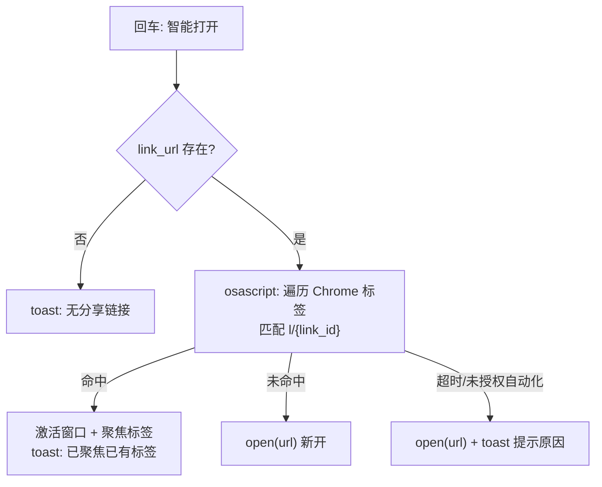

# 设计：打开文档前查重浏览器标签（Chrome）

> 2026-11-01 设计确认。解决痛点：忘记已开过某文档而重复开新标签；浏览器标签堆积混乱。

## 需求

| 项 | 决策 |
|---|---|
| 支持浏览器 | 仅 Chrome（其他浏览器后续按需加） |
| 交互 | 替换 Search / Recent 两命令的默认回车行为 |
| 匹配方式 | tab URL 包含 `l/{link_id}`（浏览器实际地址常带跳转参数，逐字符比较会漏） |
| 未命中/异常 | 回退 `open(url)` 原有行为 |

## 技术路线

Raycast API 不暴露浏览器标签。用 Node 内置 `child_process` 调 `osascript` 执行 AppleScript：遍历 Chrome 窗口/标签，匹配后直接激活对应窗口与标签。单条脚本完成「查 + 聚焦」，两次进程启动合并为一次。非网络请求，不经过 `apiFetch`；Node 内置模块，不违反「不引入新运行时依赖」红线。

## 错误处理

| 情况 | 行为 |
|---|---|
| 未命中标签 | `open(url)` 新开 |
| Chrome 未运行 | `open(url)`（自动拉起 Chrome） |
| osascript 超时（3s，`execFile` timeout） | 回退 `open(url)`，toast「查重超时」 |
| 未授权自动化权限 | 回退 `open(url)`，toast 提示系统设置授权 |
| `link_url` 为空 | 现有 `warnNoLink` 行为 |

## 分层

- `src/browser/chrome.ts`：导出 `openDocumentSmart(url)`，内部吞异常收敛为行为，命令层无感知。纯 Node，不依赖 `@raycast/api` 组件（toast 由调用方以回调/返回值处理——实现为返回状态枚举，命令层 toast）。
- 命令薄壳：回车 Action 调 `openDocumentSmart`，原 `OpenInBrowser` 降级为次要 Action。

## 置信度

- AppleScript 可枚举/激活 Chrome 标签：**已验证**（Chrome 官方 AppleScript 字典，长期稳定）。
- `link_url` 格式 `https://www.kdocs.cn/l/{link_id}`：**已验证**（`src/api/types.ts:26`）。
- Raycast 扩展内 `child_process` 可用：**已验证**（Raycast 官方支持 Node 内置模块，多个官方扩展使用）。
- 浏览器打开后 URL 仍含 `l/{link_id}`：**待实测**（加入 `docs/roadmap.md`）。
