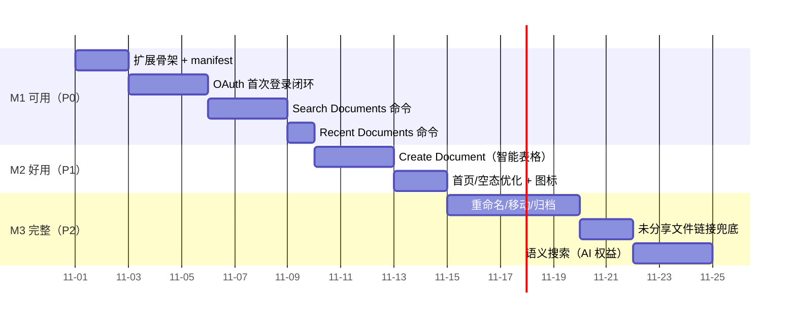

# 路线图与已知风险

## 里程碑

## M1 前置条件（管理员操作，与开发并行）

- [ ] WPS 开放平台创建「企业自建应用」
- [ ] 登记回调地址 `https://raycast.com/redirect?packageName=Extension`
- [ ] 申请 scope：`kso.file_search.readwrite`、`kso.file.readwrite`、`kso.user_base.read`
- [ ] 企业管理员审批发布

## 首版上线前必须实测的清单

| # | 待实测项 | 影响 | 兜底 |
|---|---|---|---|
| 1 | access_token / refresh_token 实际有效期 | 刷新策略 | 按 `expires_in` 动态处理，已实现 |
| 2 | `scope=latest` 时 `keyword` 传空是否合法 | Recent Documents | 改用官方最近文件端点 |
| 3 | 授权回调对 query 参数形式回调地址的接受度 | 登录闭环 | 备选登记 `https://raycast.com/redirect/extension` |
| 4 | `POST /v7/airsheet/files` 响应中文件对象字段路径 | 创建命令 | 打日志实测后固化类型 |
| 5 | 搜索结果 `link_url` 对未分享文件的表现 | 打开体验 | 走 `/v7/links/{id}/meta` 或创建分享 |

## 已知风险

| 风险 | 等级 | 应对 |
|---|---|---|
| WPS 文档为 SPA 且端点/参数可能随版本调整 | 中 | 客户端只收敛已确认字段；API 变更表现为统一 `WpsApiError`，易定位 |
| 企业管理员审批周期不可控 | 低 | M1 前置条件提前发起；开发期可用自建应用测试权限 |
| `files/search` 的 `type=content`（内容搜索）依赖 AI 入库 | 中 | 第一版以 `type=all` 实测为准；若内容搜索不可用，降级为文件名搜索并在 UI 说明 |
| 多账号/多租户用户 | 低 | token 与授权时登录的账号绑定，UI 回显用户名确认 |

## 未来演进（本版不做）

1. **轻量 token 交换后端**：若未来要上架 Raycast Store 或开放给外部企业，把 client_secret 迁到后端，扩展只持有短时 token。
2. **金山文档个人版支持**：等个人版开放平台（developer.kdocs.cn）补齐全局搜索或迁移到 WebOffice 开放平台后再评估。
3. **Windows**：Raycast Windows 版成熟后评估（本扩展代码不依赖 macOS 专属能力，理论可移植）。
