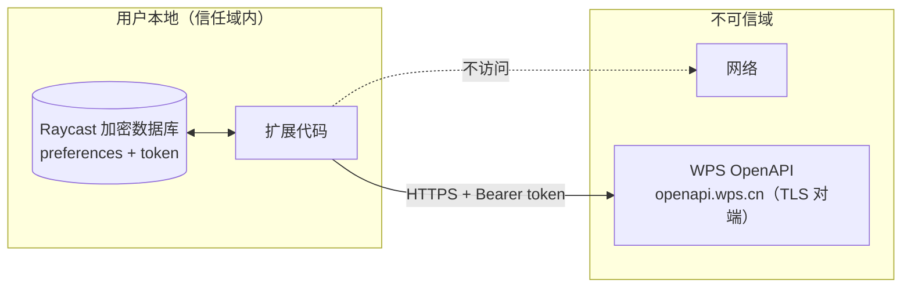

# 安全设计

> 本扩展处理两类敏感资产：**应用密钥（client_secret）** 与 **用户 token（access/refresh）**。
> 零后端方案下，两者都存储在用户本地，以下是全部信任边界与控制措施。

## 1. 信任边界

## 2. 密钥与 Token 存储

| 资产 | 存储位置 | 红线 |
|---|---|---|
| `clientSecret` | Raycast preference（`type: "password"`）→ 系统凭据托管 | ❌ 不硬编码进源码 / ❌ 不进环境变量缺省值 / ❌ 不写日志 |
| `access_token` / `refresh_token` | `PKCEClient.setTokens()` → Raycast 加密数据库 | ❌ 不存 localStorage / ❌ 不写日志 / ❌ 不复制到剪贴板 |
| 过期时间 | 编码进 TokenSet 的 `idToken` 字段（非敏感） | — |

## 3. 网络请求控制

- **域名白名单**：唯一出口 `https://openapi.wps.cn`，代码常量，无用户可控 URL → **SSRF 面为零**。
- **仅 HTTPS**，`AbortSignal.timeout(15s)` 全请求超时。
- **错误脱敏**：网络/token 接口失败只向用户展示状态码与 `msg` 字段，不透传原始响应体；`client_secret` 永不进入任何日志与错误消息。

## 4. 输入处理

- 用户输入只作为 `keyword` 查询参数经 URL 编码传输，不进入任何 shell、eval、文件路径 → 无注入面。
- API 返回的字段经类型收敛（`WpsFile`）后进 UI，React 默认转义，无 `dangerouslySetInnerHTML`。

## 5. client_secret 本地化的风险评估（零后端方案的已知代价）

| 维度 | 评估 |
|---|---|
| 攻击面 | 攻击者需已控制用户 macOS 账户才能读取 Raycast 加密库——此时已远超扩展威胁模型 |
| 影响范围 | 企业自建应用 secret 只作用于本企业，且 API 权限受 scope + 管理员审批双重限制 |
| 可逆性 | 泄露可在开放平台后台**一键重置**，旧密钥立即失效 |
| 分发范围 | 本扩展仅企业内部分发，**不上架 Raycast Store**（若上架需先迁移到后端代理方案） |

## 6. 权限最小化

- Scope 只申请三个：`kso.file_search.readwrite`（搜索）、`kso.file.readwrite`（读取文件信息/打开）、`kso.user_base.read`（回显登录用户）。不做写操作前不申请任何 write scope。
- P2 的管理功能（移动/重命名）落地时再评估增量 scope。

## 7. 验证清单

- [ ] 源码全量 grep：无任何硬编码密钥/`AKLT` 前缀/`secret =` 字面量
- [ ] 日志语句 review：不输出 token、secret、原始响应体
- [ ] token 仅存在于 `PKCEClient` 存储中（无 localStorage/Cache 写入）
- [ ] 所有 fetch 走 `apiFetch` 统一入口（白名单域名 + 超时）
- [ ] CI/发布前跑 `npm run lint`（@raycast/eslint-config 内含安全规则）
